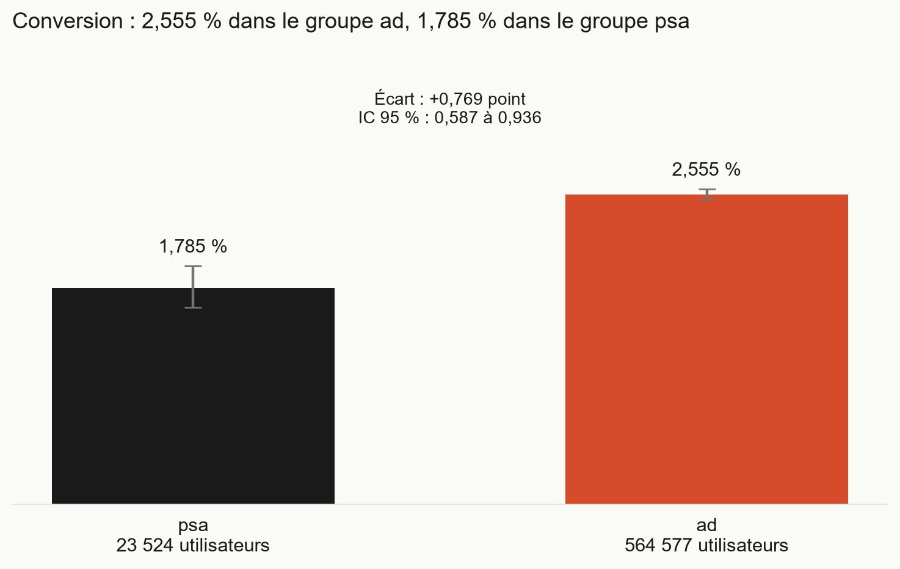
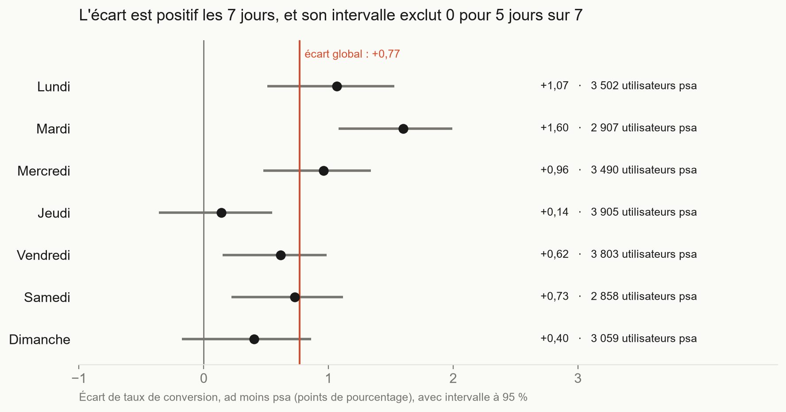
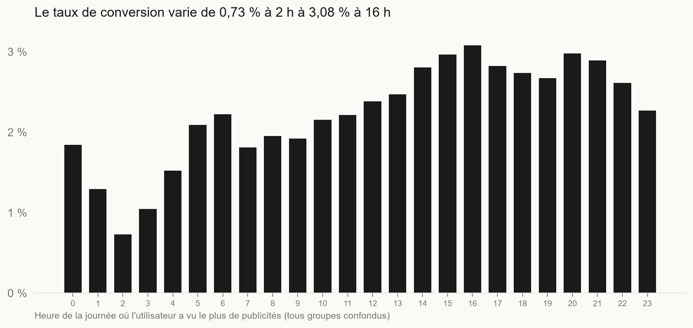
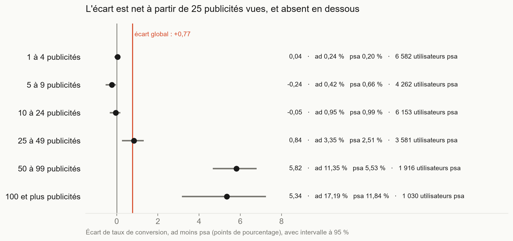

# Test A/B sur une campagne publicitaire

Une publicité augmente-t-elle le taux de conversion ? Analyse d'un test A/B de 588 101 utilisateurs, avec test statistique, intervalles de confiance et vérifications de robustesse.

## Contexte

Le jeu de données [Marketing A/B Testing](https://www.kaggle.com/datasets/faviovaz/marketing-ab-testing) (Kaggle) contient 588 101 utilisateurs répartis en deux groupes :

- `ad` : ils ont vu la publicité (564 577 utilisateurs, 96,0 %) ;
- `psa` : ils ont vu un message d'intérêt général à la place (23 524 utilisateurs, 4,0 %). Ce groupe sert de point de comparaison.

Pour chaque utilisateur : a-t-il acheté (`converted`), combien de publicités a-t-il vues (`total ads`), quel jour (`most ads day`) et à quelle heure (`most ads hour`) en a-t-il vu le plus.

## Objectif

Mesurer l'écart de conversion entre `ad` et `psa`, dire s'il est solide, puis conclure en une phrase.

## Technologies

Python, pandas, NumPy, SciPy, statsmodels, Matplotlib.

## Méthode

1. **Contrôle des données** : aucune valeur manquante, aucun doublon d'identifiant.
2. **Équilibre des groupes** : jour, heure et nombre de publicités vues sont comparés entre `ad` et `psa`.
3. **Test principal** : test z sur deux proportions, avec l'écart en points, son intervalle de confiance à 95 % (méthode de Newcombe) et le rapport des taux.
4. **Ajustement** : régression logistique et standardisation sur le jour et l'heure.
5. **Robustesse** : l'écart est recalculé par jour, par période de la journée et par niveau d'exposition.

### Termes statistiques

- **Test z sur deux proportions** : compare deux taux et dit si leur écart dépasse ce que le hasard produirait.
- **Intervalle de confiance à 95 %** : fourchette dans laquelle l'écart se situe, avec la méthode utilisée. Plus il est étroit, plus l'estimation est précise.
- **V de Cramér** : taille de l'écart entre deux répartitions, de 0 (identiques) à 1 (totalement différentes). Avec 588 101 lignes, une différence minuscule donne déjà une p-valeur minuscule. Le V permet de juger si elle compte.
- **Odds ratio** : rapport de cotes issu de la régression logistique. Il diffère du rapport des taux, plus simple à lire quand les taux sont bas.
- **Standardisation** : taux recalculé comme si les deux groupes avaient la même répartition de jours et d'heures.
- **Test du rapport de vraisemblance** : sert ici à tester si l'effet de la publicité change selon le jour, l'heure ou l'exposition (interaction).
- **Plus petit écart détectable** : écart en dessous duquel ce test ne verrait rien, vu les effectifs.

## Résultats

### 1. La publicité est associée à un taux de conversion plus élevé

| Groupe | Utilisateurs | Convertis | Taux de conversion |
|---|---:|---:|---:|
| `ad` | 564 577 | 14 423 | 2,555 % |
| `psa` | 23 524 | 420 | 1,785 % |

- Écart : **+0,77 point** (IC 95 % : 0,59 à 0,94), soit +43,1 % en relatif.
- Rapport des taux : 1,43 (IC 95 % : 1,30 à 1,58).
- Test z : z = 7,37, p = 1,7e-13.



L'ajustement sur le jour et l'heure ne change rien : odds ratio de 1,442 (IC 95 % : 1,31 à 1,59) avec ou sans ajustement, et écart standardisé de 0,769 point. Les groupes diffèrent peu sur ces deux variables (V de Cramér de 0,020 pour le jour et de 0,018 pour l'heure).

Le test détecte des écarts d'environ 0,29 point ou plus (puissance de 80 %, seuil de 5 %, approximation).

Je n'ajuste pas sur le nombre de publicités vues : il est mesuré pendant la campagne, donc il peut déjà être influencé par le groupe.

### 2. L'écart est positif chaque jour, mais pas de la même taille



L'écart est positif les 7 jours. Son intervalle exclut 0 pour 5 jours sur 7 (il contient 0 le jeudi et le dimanche). Il va de +0,14 point (jeudi) à +1,60 point (mardi). Le test d'interaction confirme que l'effet varie selon le jour (p = 0,011). Je n'ai pas d'explication pour le mardi.

### 3. La conversion varie beaucoup selon l'heure



Tous groupes confondus, le taux va de 0,73 % à 2 h (5 333 utilisateurs) à 3,08 % à 16 h (37 567 utilisateurs). L'effet de la publicité varie aussi selon la période de la journée (4 périodes, p = 0,013). Le même test sur les 24 heures n'a pas convergé : je ne l'utilise pas.

### 4. L'écart se concentre sur les utilisateurs très exposés

| Publicités vues | Utilisateurs `ad` | Utilisateurs `psa` | Taux `ad` | Taux `psa` | Écart (points) | IC 95 % |
|---|---:|---:|---:|---:|---:|---|
| 1 à 4 | 141 938 | 6 582 | 0,24 % | 0,20 % | +0,04 | −0,10 à 0,13 |
| 5 à 9 | 96 128 | 4 262 | 0,42 % | 0,66 % | −0,24 | −0,53 à −0,03 |
| 10 à 24 | 167 070 | 6 153 | 0,95 % | 0,99 % | −0,05 | −0,33 à 0,18 |
| 25 à 49 | 91 293 | 3 581 | 3,35 % | 2,51 % | +0,84 | 0,26 à 1,32 |
| 50 à 99 | 45 709 | 1 916 | 11,35 % | 5,53 % | +5,82 | 4,67 à 6,80 |
| 100 et plus | 22 439 | 1 030 | 17,19 % | 11,85 % | +5,34 | 3,17 à 7,24 |



En regroupant :

| | Taux `ad` | Taux `psa` | Écart | IC 95 % |
|---|---:|---:|---:|---|
| Moins de 25 publicités | 0,572 % | 0,600 % | −0,03 point | −0,16 à 0,08 |
| 25 publicités ou plus | 7,592 % | 4,872 % | +2,72 points | 2,16 à 3,23 |

L'interaction entre le groupe et la tranche d'exposition est la plus marquée des trois testées (χ² = 42,6, 5 degrés de liberté, p = 4,4e-08). Sous 25 publicités, aucun gain n'est détecté. La tranche 5 à 9 est légèrement négative ; je ne l'interprète pas.

Les utilisateurs exposés 25 fois ou plus sont environ 28 % des utilisateurs dans chaque groupe (28,2 % dans `ad`, 27,7 % dans `psa`). Ils regroupent 83,9 % des convertis de `ad`, mais aussi 75,7 % de ceux de `psa`. Cette concentration existe donc sans la publicité. Ce qui distingue `ad`, c'est l'écart avec `psa` à niveau d'exposition comparable.

## Recommandation

> Garder la publicité, à comparer au coût de la campagne : elle est associée à +0,77 point de conversion en moyenne, mais l'écart se concentre sur les utilisateurs qui voient 25 publicités ou plus (+2,7 points, IC 95 % : 2,2 à 3,2) et disparaît en dessous.

## Limites

- **Allocation inconnue.** Le jeu de données ne dit pas comment les utilisateurs ont été répartis entre `ad` (96 %) et `psa` (4 %). Les groupes sont proches sur le jour et l'heure, mais je ne peux pas exclure d'autres différences. L'écart est donc *associé* à la publicité, pas démontré comme *causé* par elle.
- **Pas de données de coût ni de montant.** `converted` est binaire. Je ne peux pas dire si la campagne est rentable.
- **Peu de convertis dans `psa`** (420). C'est ce qui fixe la largeur des intervalles. Dans les tranches sous 25 publicités, `psa` compte 13, 28 et 61 convertis : ces estimations sont fragiles.
- **Variables mesurées pendant la campagne.** Le nombre de publicités vues, le jour et l'heure décrivent le comportement de l'utilisateur, pas des caractéristiques de départ. Les tranches de 25, 50 et 100 sont arbitraires : 25 n'est pas un seuil à partir duquel la publicité « fonctionne ».
- **Effet moyen.** L'écart de +0,77 point mélange des situations très différentes (jour, période, exposition).
- **Jeu de données non redistribué.** Il se télécharge sur Kaggle.

## Reproduire

1. Télécharger le CSV sur Kaggle et le placer dans `data/` sous le nom `marketing_AB.csv`. Si le nom diffère, le modifier dans chaque script (constante `Path("data") / ...`).
2. Installer l'environnement (PowerShell) :

```
python -m venv .venv
.venv\Scripts\Activate.ps1
pip install -r requirements.txt
```

3. Lancer les scripts dans cet ordre :

```
python apercu.py
python controles.py
python equilibre.py
python test_principal.py
python graphiques.py
python robustesse.py
python exposition.py
```

## Contenu du dépôt

| Fichier | Rôle |
|---|---|
| `apercu.py` | Structure du fichier, types, premières lignes |
| `controles.py` | Valeurs manquantes, doublons, répartition des groupes |
| `equilibre.py` | Comparaison des groupes sur le jour, l'heure et le nombre de publicités |
| `test_principal.py` | Test z, intervalles, régression logistique, standardisation, puissance |
| `graphiques.py` | Graphiques 01 à 03 |
| `robustesse.py` | Interactions avec le jour, la période et l'heure ; écart par tranche |
| `exposition.py` | Écart par niveau d'exposition, graphique 04 |
| `docs/` | Graphiques utilisés dans ce README |

## Auteur

Rayane Berrada, [GitHub](https://github.com/iitsh) · [LinkedIn](https://linkedin.com/in/rayane-berrada-734093352)